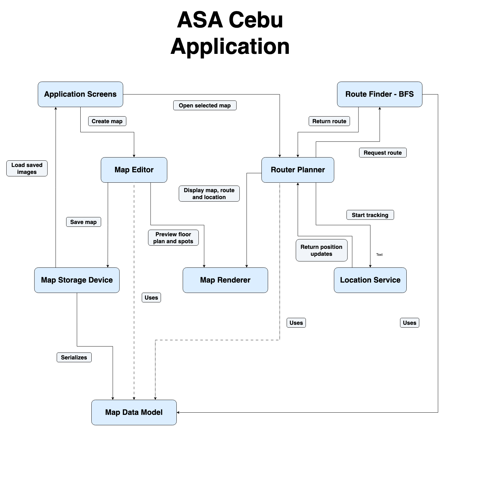
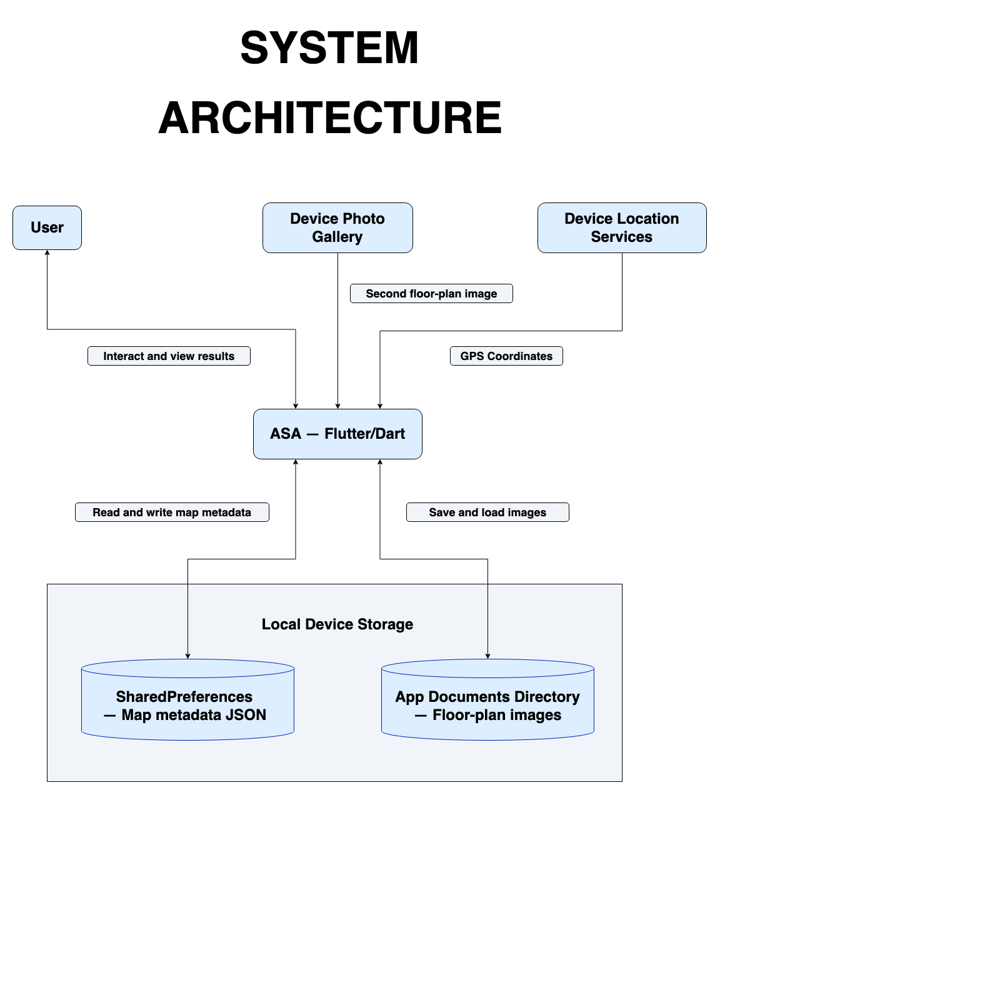

# ASA Cebu

ASA Cebu is a Flutter prototype for browsing indoor mall maps and planning routes. It includes Home, Maps, and Settings screens, a sample SM Seaside City Cebu map, an admin map editor, and live movement tracking during navigation.

## Features

- Browse the sample mall map and maps saved on the device.
- Create maps with one or more floor-plan images, labeled spots, and connections between spots. Connections can link floors through stairs, elevators, or escalators.
- Find routes through the saved connections. The route finder uses breadth-first search (BFS), so it chooses the route with the fewest connections; it does not calculate the shortest physical walking distance.
- During navigation, show only the route's spots and connections, with a blue location dot. The dot starts at the selected starting spot and then estimates movement from device location updates. It does not continuously place the dot from the phone's absolute latitude and longitude. Indoor GPS and compass readings can be inaccurate, so the dot is an estimate.
- Save map metadata locally with SharedPreferences and copy floor-plan images to the app's documents directory. Maps are not synced to Supabase or other devices.

## Run the app

Install Flutter with a Dart SDK compatible with the constraint in `pubspec.yaml` (Dart 3.13.5 or later within the allowed SDK range), then run:

```sh
flutter pub get
flutter run
```

Run the Flutter test suite with:

```sh
flutter test
```

For an Android release APK:

```sh
flutter build apk --release
```

The APK is written to `build/app/outputs/flutter-apk/app-release.apk`. The current Android Gradle configuration uses the debug signing key and the placeholder application ID `com.example.asa`. This is suitable for local installs and testing, but prepare a unique application ID and permanent release signing key before publishing through Google Play. The Play Store normally expects an Android App Bundle, which can be built with `flutter build appbundle`.

## Admin access

Admin map tools are hidden from regular users. Tap the **Settings** tab or the **Settings** heading 10 times to open the admin sign-in form. Sign in with an email and password for an existing Supabase Auth user. The account must be able to use email/password authentication in the configured Supabase project. Admin sign-in controls access to the editor in the app; it is not server-side authorization for map files stored on a device.

The app uses its Supabase URL and publishable key for client authentication. A publishable key is intended for client apps; never put a Supabase secret or service-role key in the app. Supabase is used for admin authentication only. Map data and uploaded floor-plan images remain local to each device.

## Create or edit a map

1. Sign in as an admin, then open **Settings → Maps** to edit a map or **Settings → Add map** to create one.
2. Enter the mall name and its latitude, longitude, and radius. The location and radius provide a rough GPS scale for the floor plan; the app does not currently use the radius to verify that the phone is inside a geofence.
3. Upload a floor-plan image. Add and name more floors if needed.
4. Optionally enter the floor plan's real width and height in meters for a better movement scale. When dimensions are entered, the app uses the mall coordinates as the center of that floor plan and assumes the image is north-up. If dimensions are blank, the mall radius provides a rough scale. No store-by-store GPS coordinates are required.
5. Select **Add spot**, tap the floor plan, and choose a spot type: Pathway, Store, Restroom, Escalator, Elevator, Stairs, or Custom. Pathway, restroom, elevator, escalator, and stairs names can be left blank; stores and custom spots need labels.
6. Select **Connect spots**, then tap two spots to create a connection. Selecting an existing connection again removes it. To connect floors, connect matching stair, elevator, or escalator spots while switching floors in connection mode.
7. Tap a spot while adding spots to rename or delete it. Save the map when finished.

Maps and copied images are stored in the app's private documents directory, so they persist after the app restarts. They are not written back to the source `assets/` folder. To ship a map as built-in app content, add its data and images to the project and include them in the app build.

## Plan and start navigation

1. Open a map and choose the starting spot and destination. The selectors support searching by spot name.
2. Tap **Show route** to calculate the route and review its summary.
3. Tap **Start navigation** to request location permission and begin tracking. The route and blue dot appear during active navigation. The blue dot is initialized at the selected starting spot and follows estimated device movement. If you switch floors, confirm **I changed floors** to transfer the dot to the route's corresponding spot; choose **Just previewing** to view another floor without moving the dot there.

The phone's location services must be enabled and location permission granted for navigation. Movement tracking can drift or fail to represent indoor position accurately because phone GPS and compass sensors are not designed for precise indoor positioning. Providing accurate floor dimensions improves the map scale but does not make the location estimate exact.

## Component Responsibilities

| Part                           | Responsibility                                                                                             |
| ------------------------------ | ---------------------------------------------------------------------------------------------------------- |
| Application screens            | Home, Maps, Settings, route planning, and admin map management.                                            |
| Map editor                     | Imports floor plans and edits floors, spots, connections, mall coordinates, and optional floor dimensions. |
| Map storage                    | Saves map metadata with SharedPreferences and floor-plan image copies in the app documents directory.      |
| Route planner and route finder | Plans a path and finds a route through the map graph using breadth-first search (BFS).                       |
| Location service               | Requests device location updates and estimates relative movement on the floor plan.                        |
| Map renderer                   | Draws floor plans, spots, route connections, zoom controls, and the blue location marker.                  |
| Map data model                 | Represents malls, floors, spots, connections, and optional scale calibration data.                         |

## Technologies and Platforms

| Technology             | Use                                                                                         |
| ---------------------- | ------------------------------------------------------------------------------------------- |
| Flutter and Dart       | App interface, map editor, routing, and local application logic.                            |
| Geolocator             | Location permission and phone location updates used to estimate movement during navigation. |
| Flutter Compass        | Reads device heading for the map's direction indicator.                                     |
| Image Picker           | Imports floor-plan images from the device.                                                  |
| SharedPreferences      | Stores map metadata and configuration on the device.                                        |
| Path Provider and Path | Locate the app documents directory and construct local image paths.                         |
| Supabase Flutter       | Email/password authentication for admin access. It does not store the maps.                 |
| Flutter Test           | Widget and unit tests in the `test/` directory.                                             |

### Tested platforms

- **Android:** A release APK has been built successfully with `flutter build apk --release`. The repository does not record a physical phone model or installed-device test results.
- **iOS, web, Windows, macOS, and Linux:** No platform test results are documented.

## High-Level Components Diagram



[Open the original diagram in diagrams.net](https://app.diagrams.net/#G1gtlDd1yyCnfU8ZqQM6--QSLq9BXbescq#%7B%22pageId%22%3A%22-cAy09rdLC6Mv3cbl7wk%22%7D) · [View the local editable source](docs/diagrams/high-level-components.drawio)

## High-Level System Architecture



[Open the original diagram in diagrams.net](https://app.diagrams.net/#G1qIpIt_8bde9AnZptSAOIp0qwWZEqPSEJ) · [View the local editable source](docs/diagrams/high-level-architecture.drawio)

The components diagram shows the implemented BFS route finder and position updates. Both diagrams are architecture overviews; the current implementation details and limitations are described above.

## Technology Impact

### Interface and map visualization

Flutter and Dart provide the screens and interactive floor-plan view. The map renderer shows uploaded floor plans, spots, connections, routes, zoom and pan controls, and the current-location marker.

### Map creation and local access

Admins can import floor plans and define multiple floors, labeled spots, and connections without changing application code. Map metadata is stored locally, and floor-plan files are copied into the app's documents directory. Saved maps remain on that device after an app restart and are available offline; they are not synchronized across devices.

### Location-aware navigation

Geolocator and the compass sensor provide movement and heading updates for the blue dot. The dot starts at the user-selected map point and estimates subsequent movement. Indoor sensor data can drift, so it is an approximate indicator rather than a precise indoor positioning system. The mall radius is used as a rough map scale; the app does not currently enforce a mall geofence.

### Route calculation

The route finder uses breadth-first search to minimize the number of connections. Connections do not have distance or accessibility weights, so the selected path may not be the physically shortest or most accessible route.

## License

No project license has been selected and no `LICENSE` file is present. Reuse and redistribution permissions have not been specified.

## Progress Documentation

The app version in `pubspec.yaml` is `1.0.0+1`. The README and linked architecture documents provide project and system context, and the project notes Jira for task tracking. There is no changelog or versioned specification document in the repository at this time. Add releases and specification updates here as those records are created.

## Contribution Readiness

This README documents environment setup, running the app, tests, and Android builds. The repository does not currently include a `CONTRIBUTING.md`, issue templates, a pull request template, or a `CODE_OF_CONDUCT.md`. It also does not specify tested device models or OS versions. Add those project policies and verified device details before inviting outside contributors.

## Demonstration Quality

No demo video or public demonstration link is currently documented. Add a short video or hosted demo link here when one is available.

## Implementation Completeness

The prototype includes local map browsing and editing, multi-floor maps and connections, BFS route planning, Supabase-backed admin sign-in, and approximate movement tracking during navigation. Remaining limitations include approximate indoor positioning, no server-side map storage or cross-device sync, no geofence enforcement, and route selection based on connection count rather than walking distance. The Android release configuration still uses the debug signing key and `com.example.asa`; create a unique application ID and configure permanent release signing before a public Play Store release.

## Project notes

- `assests/data/sm_seaside.json` is retained in the repository but is not currently loaded by the app. The sample map is defined in the app code and has no bundled floor-plan image; an admin can upload an image when editing it.

## References and project tracking

GitHub is used for source control and Jira is used to organize project requirements and work.
